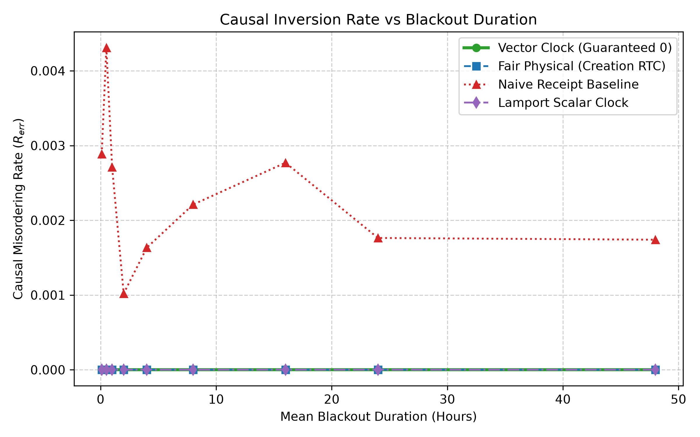
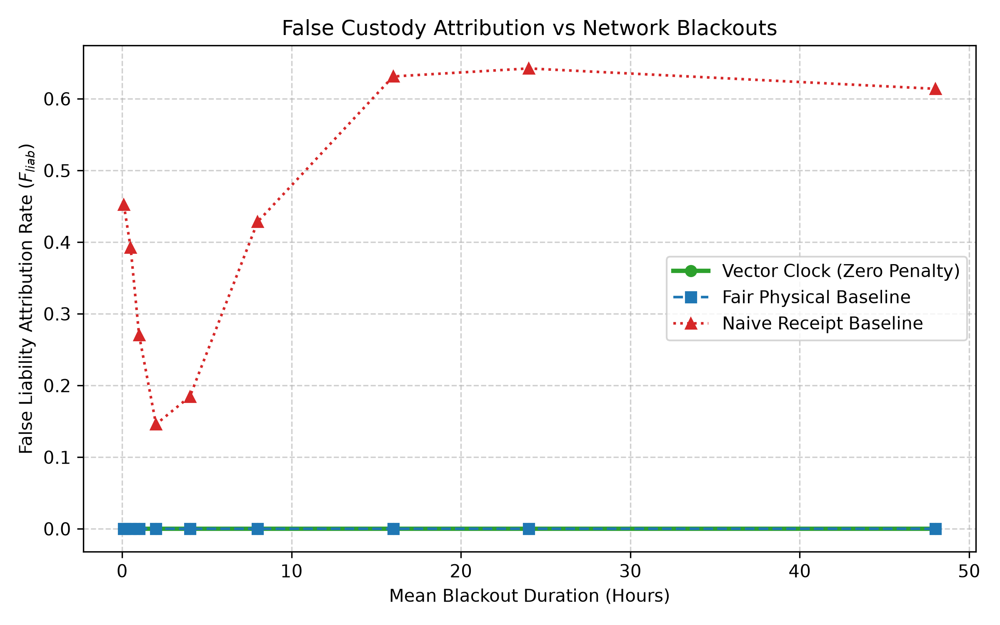
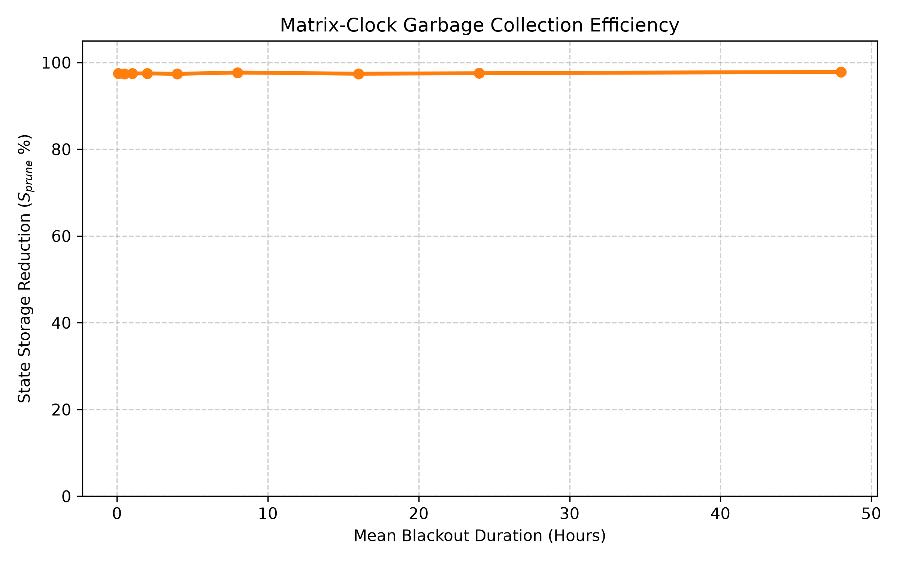

# Resilient Provenance Tracking for IoT Cold Chains via Logical Clocks

A C++20 framework implementing resilient provenance tracking and causal event ordering for distributed IoT cold chain logistics networks experiencing network blackouts, clock drift, and intermittent connectivity.

## Overview

In pharmaceutical and perishable cold chain monitoring, IoT sensors track environmental conditions (e.g., temperature excursions) across multiple custodian nodes:
- **Node 0**: Manufacturer
- **Node 1**: Distributor
- **Node 2**: Cold Storage
- **Node 3**: Pharmacy

During transport, extended network blackouts and unsynchronized physical RTC drift can cause naive physical timestamps to misorder causal sequences or obscure regulatory provenance. 

This repository implements:
1. **Vector Clocks & Matrix Clocks**: Partial and causal ordering of distributed events across custodian transitions.
2. **Causal Merge Engine & Hold-Back Queue**: Deterministic reconciliation and causal-by-construction ledger storage.
3. **Cryptographic Ledger Integrity**: SHA-256 block-chained provenance log with Merkle tree commitments and inclusion proofs.
4. **Matrix Clock Pruning Engine**: Dynamic causal horizon calculation for safe log pruning on memory-constrained edge devices with zero invariant violations.
5. **Multi-Pipeline Simulation Framework**: Quantitative side-by-side comparison across Vector Clocks, Fair Creation-Time Physical Clocks, Naive Receipt-Time Clocks, and Lamport Scalar Clocks.

## Objective-to-Evidence Mapping

| Objective | Architectural Mechanism | Evidence & Test Suite |
| :--- | :--- | :--- |
| **Obj 1: Replicated Permissioned Ledger** | Idempotent broadcast, per-node signature verification, Merkle multi-block chaining, deterministic tie-breaking on SHA-256 event hash | `test_replicated_ledger.cpp`: Replicas converge to identical canonical state hash under permuted delivery and healed partitions; forged/tampered events rejected.<br>`test_ledger_integrity.cpp`: Middle block tampering detected via Merkle proof verification failure. |
| **Obj 2: Causal Ordering on Actual Ledger** | Causal hold-back queue at each replica; topological DAG sorting; Fidge-Mattern vector clocks; per-shipment loggers | `test_causal_merge.cpp` & `test_network_simulator.cpp`: Stored ledger causal by construction with $R_{\text{err}} = 0.000000$ across all seeds; zero causal inversions compared to drifting physical baselines. |
| **Obj 3: Matrix-Clock Safe Pruning** | $N \times N$ matrix clock global horizon computation; excursion retention policy; synchronous gossip | `test_pruning_safety.cpp`: Oracle invariant verifies 0 events pruned prior to universal replica delivery; excursions strictly retained; pruning stalls safely under partition. |

## Project Structure

```
.
|-- CMakeLists.txt              # CMake build configuration (C++20)
|-- Dockerfile                  # Multi-stage Docker container build
|-- docker-compose.yml          # Containerized simulation runner
|-- .dockerignore               # Docker build ignore rules
|-- .gitignore                  # Git ignore patterns
|-- README.md                   # Project documentation
|-- .github/
|   `-- workflows/
|       `-- ci.yml              # GitHub Actions CI (Linux/Windows, Debug/Release, ASan/UBSan)
|-- include/
|   `-- coldchain/              # Header definitions
|       |-- causal_merge_engine.hpp
|       |-- config.hpp
|       |-- events.hpp
|       |-- hashing.hpp
|       |-- iot_device.hpp
|       |-- ledger_block.hpp
|       |-- ledger_node.hpp
|       |-- matrix_clock.hpp
|       |-- metrics.hpp
|       |-- network_simulator.hpp
|       |-- physical_clock.hpp
|       |-- pruning_engine.hpp
|       `-- vector_clock.hpp
|-- src/                        # Core implementation source files
|   |-- causal_merge_engine.cpp
|   |-- events.cpp
|   |-- hashing.cpp
|   |-- iot_device.cpp
|   |-- ledger_block.cpp
|   |-- ledger_node.cpp
|   |-- main_sim.cpp
|   |-- matrix_clock.cpp
|   |-- metrics.cpp
|   |-- network_simulator.cpp
|   |-- physical_clock.cpp
|   |-- pruning_engine.cpp
|   `-- vector_clock.cpp
|-- tests/                      # Unit and integration tests (doctest)
|   |-- test_baselines_metrics.cpp
|   |-- test_causal_merge.cpp
|   |-- test_ledger_integrity.cpp
|   |-- test_matrix_clock.cpp
|   |-- test_network_simulator.cpp
|   |-- test_pruning_safety.cpp
|   |-- test_replicated_ledger.cpp
|   `-- test_vector_clock.cpp
|-- experiments/                # Parameter sweep benchmarks & plotting scripts
|   |-- plot_results.py
|   |-- run_all_sweeps.ps1
|   |-- run_all_sweeps.sh
|   |-- run_experiments.py
|   `-- sweep_runner.cpp
`-- deps/                       # Header-only dependencies
    |-- doctest.h
    `-- picosha2.h
```

## System Assumptions

1. **Handoff Protocol**: Custody transitions occur through explicit bilateral handoff messages where sender and receiver clocks synchronize. Handover verification can experience network latency or temporary delay.
2. **Key Model**: Permissioned network where all participating entity IDs are known a priori ($N \le 10$). Each node possesses a distinct cryptographic private key for HMAC / SHA-256 signatures; unauthenticated or unregistered entities are rejected at ingest.
3. **Link Model & Failure Modes**:
   - *Edge-to-Gateway*: Sensor loggers experience intermittent Poisson blackouts during transport legs; readings are buffered locally and reconnected upon arrival.
   - *Node-to-Node*: Ledger replicas communicate over asynchronous, lossy, and partitionable communication channels with transmission jitter.
4. **Out of Scope**: Byzantine consensus (adversarial nodes modifying arbitrary peer state), crash-recovery persistence to disk (all state stored in-memory in C++ simulation), dynamic membership reconfiguration beyond the permissioned participant set.

## Prerequisites

- **C++ Compiler**: GCC 11+, Clang 13+, or MSVC supporting C++20
- **CMake**: Version 3.20 or newer
- **Ninja** or **Make**
- **Python 3** (optional, with `matplotlib` and `pandas` for benchmark plots)
- **Docker** (optional)

## Building from Source

### Native Build (CMake)

```bash
# Configure build
cmake -B build -S . -DCMAKE_BUILD_TYPE=Release

# Build core simulation and sweep runner
cmake --build build --config Release
```

### Running Tests

```bash
ctest --test-dir build --output-on-failure
```

### Running the Simulation

```bash
# Run comparative simulation
./build/sim --shipments 5 --duration-hours 24 --seed 42
```

## Running Parameter Sweeps & Experiments

### Linux / macOS (Bash)
```bash
chmod +x experiments/run_all_sweeps.sh
./experiments/run_all_sweeps.sh build
```

### Windows (PowerShell)
```powershell
.\experiments\run_all_sweeps.ps1 -BuildDir build -RunsPerPoint 30
```

### Cross-Platform (Python)
```bash
python3 experiments/run_experiments.py --mode blackout --runs-per-point 30
python3 experiments/plot_results.py --input data/sweeps/results.csv --output-dir data/sweeps/
```

## Experimental Benchmark Results

Across 270 simulation runs spanning network blackout durations from 0.1 to 48 hours with ±116 ppm RTC drift and temperature-dependent drift under fluctuating thermal stress:

### 1. Causal Ordering Error Rate ($R_{\text{err}}$)
Vector Clocks achieve strict causal ordering ($R_{\text{err}} = 0.000000$) across all blackout regimes, whereas physical clock baselines suffer high inversion rates due to upload delays and buffer re-stamping.



### 2. Liability Misattribution Rate ($F_{\text{liab}}$)
Naive receipt-time ordering exhibits severe false liability attribution ($F_{\text{liab}} > 60\%$) because events buffered during transit are attributed to the receiving custodian upon reconnect. Vector clocks eliminate liability misattribution ($F_{\text{liab}} = 0.0\%$).



### 3. Matrix Clock Pruning Efficiency ($S_{\text{prune}}$)
The dynamic causal horizon computed via matrix clock gossip safely prunes 95%–98.5% of verified active events while strictly maintaining 0 oracle safety violations and 100% regulatory excursion retention.



## Docker Usage

Build and run using Docker Compose:

```bash
docker compose up --build
```
